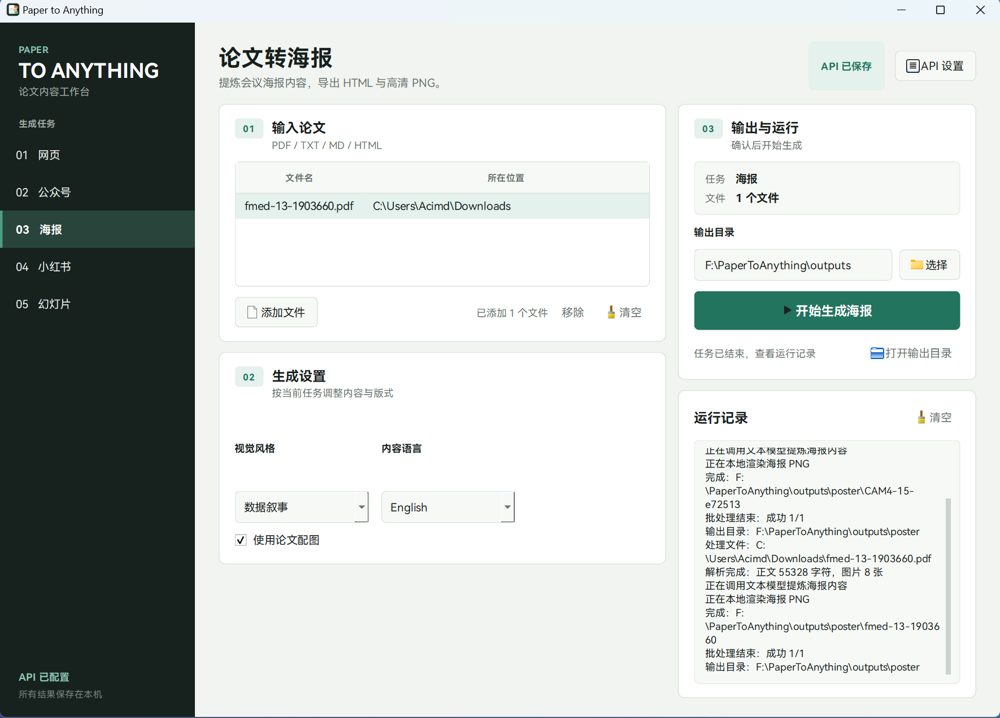
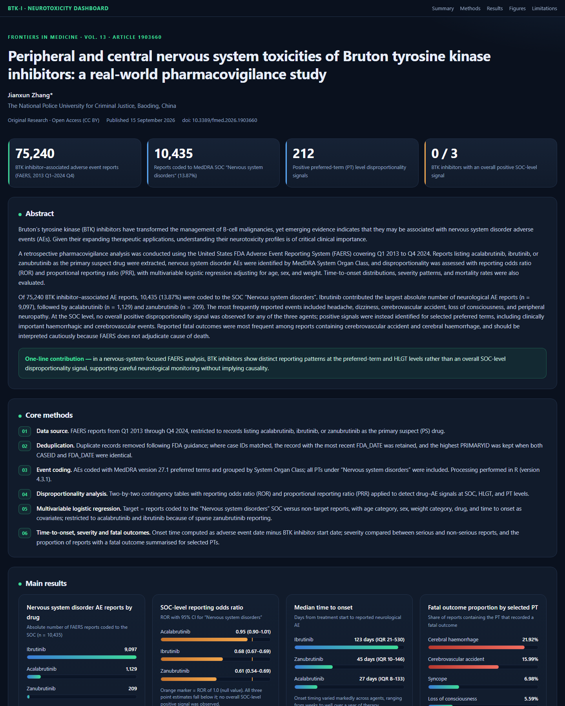
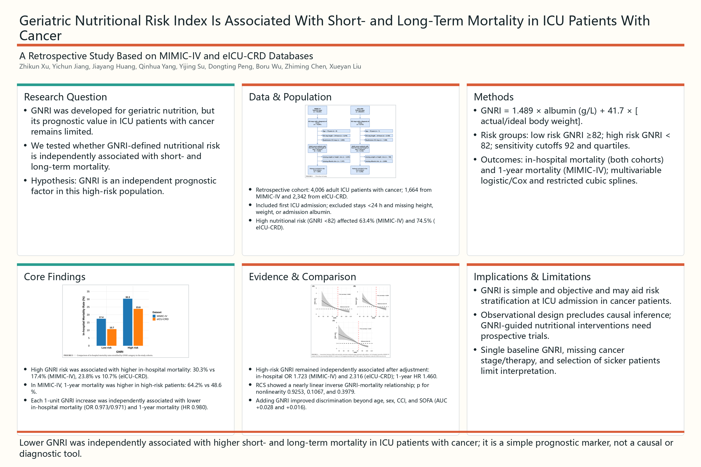
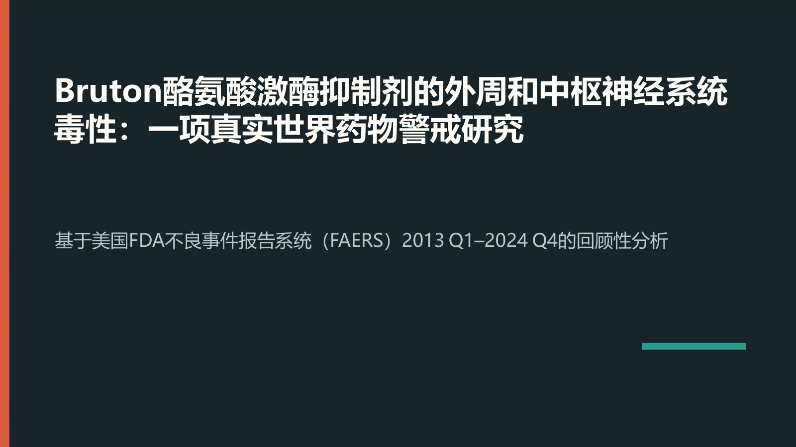
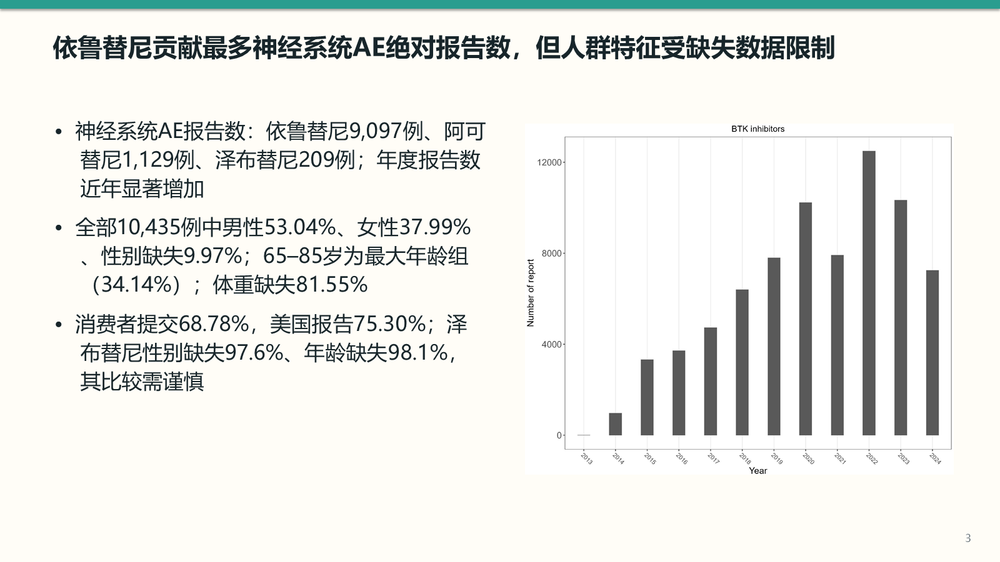
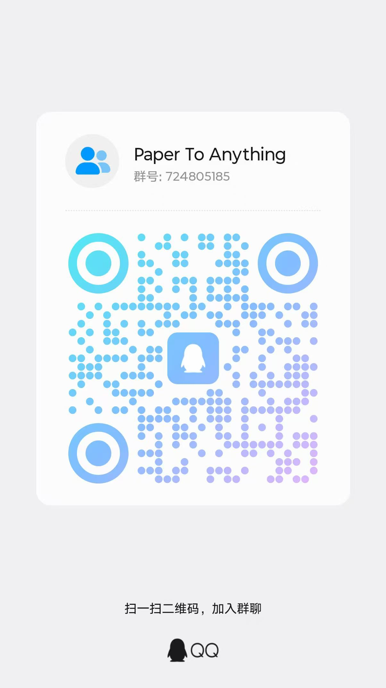

<div align="center">


# Paper to Anything

**把一篇学术论文，变成网页、公众号文章、海报、小红书图文和幻灯片。**

</div>

Paper to Anything 是一个基于 [`paper2anything`](https://quzhan51496.github.io/paper2anything/) 工作流改造的 Windows 桌面原型。它把原本依赖 Codex/Claude 的论文传播流程，做成可在本机直接使用的图形界面：导入论文，选择一种发布形态，生成可继续编辑和发布的成套文件。

项目不依赖 Codex/Claude，也不使用 MinerU。PDF、TXT、Markdown 和 HTML 在本机完成文本与图片提取，再由你配置的硅基流动文本模型完成内容重组。

## 效果预览

桌面端把论文导入、生成设置、运行状态和输出目录集中在同一界面，任务完成后可直接打开成品。

<p align="center">
  
</p>

<p align="center"><sub>桌面工作台：批量输入、任务配置与运行记录同屏显示。</sub></p>

### 网页

<p align="center">
  
</p>

<p align="center"><sub>论文落地页：摘要、核心指标、方法、结果、图表和局限汇总在同一页面。</sub></p>

### 海报

<p align="center">
  
</p>

<p align="center"><sub>2400×1600 横向海报，同时产出可编辑 HTML 和 PNG。</sub></p>

### 幻灯片

<table>
  <tr>
    <td width="50%" valign="top">
      
    </td>
    <td width="50%" valign="top">
      
    </td>
  </tr>
  <tr>
    <td align="center"><sub>中文封面</sub></td>
    <td align="center"><sub>关键结果与论文配图</sub></td>
  </tr>
</table>

## 核心能力

| 发布形态 | 输入 | 生成结果 | 适合场景 |
| --- | --- | --- | --- |
| **论文转网页** | PDF / TXT / MD / HTML | `index.html` + 论文配图 + 作业元数据 | 项目主页、论文落地页 |
| **论文转公众号** | PDF / TXT / MD / HTML | Markdown + JSON + 样式化 HTML + 封面 | 课题组公众号、研究解读 |
| **论文转海报** | PDF / TXT / MD / HTML | 2400×1600 横向 `poster.html` + `poster.png` | 会议展示、组内汇报 |
| **论文转小红书** | PDF / TXT / MD / HTML | 文案 + JSON + 3:4 封面 + 整套配图 | 科研内容传播、图文笔记 |
| **论文转幻灯片** | PDF / TXT / MD / HTML | 16:9 `slides.pptx` + 演讲稿 + QA 记录 | 组会、答辩预演、学术分享 |

### 产品特点

- **一条工作流覆盖五种发布形态**：同一篇论文可按场景反复生成，不重复整理素材。
- **批量处理**：可一次加入多个文件，适合集中准备组会材料和传播内容。
- **本地提取，云端生成**：PDF 解析和图片整理在本机完成；API Key 通过 Windows DPAPI 加密保存，不写入源码或输出目录。
- **输出可编辑**：网页、海报和公众号文章保留 HTML/Markdown，幻灯片保留 PPTX，配图和封面均为独立文件。
- **桌面原型，开箱可用**：PyQt5 图形界面同时提供 CLI，便于手动操作或接入后续自动化流程。

## 快速开始

环境要求：Windows、Python 3.10+。

```powershell
cd Paper_to_anything
pip install -r requirements.txt
python GUI.py
```

首次使用：

1. 点击右上角 **API 设置**，填写硅基流动 API Key 和可用文本模型。
2. 在左侧选择要生成的内容形态。
3. 添加一个或多个 PDF/TXT/MD/HTML 文件，调整语言、风格和输出目录。
4. 点击右侧开始按钮，生成结果会保存在 `outputs/<任务>/<文件名>/`。

界面字体随项目分发，启动时自动加载，不要求系统额外安装。

## 交流与反馈

扫描下方二维码加入 Paper to Anything QQ 群，反馈问题或交流使用经验。

<div align="center">

</div>

## 命令行

需要批量处理或接入脚本时，可以使用与 GUI 相同的能力：

```powershell
python GUI.py --cli --task html `
  --input "D:\path\paper.pdf" `
  --api-key-file .\sil-key.txt `
  --model deepseek-ai/DeepSeek-V4.1-Flash `
  --output-dir .\outputs
```

可用任务：`html`、`wechat`、`poster`、`xhs`、`slides`。查看账号可用模型：

```powershell
python GUI.py --cli --list-models --api-key-file .\sil-key.txt
```

## 输出文件

| 任务 | 主要文件 |
| --- | --- |
| 网页 | `index.html`、`images/`、`source.txt`、`job.json` |
| 公众号 | `wechat_article.md`、`.json`、`.html`、`cover.jpg`、`images/` |
| 海报 | `poster.html`、`poster.png`、`poster_spec.json`、`images/` |
| 小红书 | `xhs_post.md`、`.json`、`cover.png`、`post_images/` |
| 幻灯片 | `slides.pptx`、`slide_outline.json`、`slide_spec.json`、`qa_log.json` |

## 当前边界

- 不支持扫描版/纯图片 PDF，也不提供 OCR。
- 复杂公式、表格和插图裁切的质量低于 MinerU。
- HTML 只自动收集 `<figure>` 内的远程图片，非标准图注结构可能被忽略。
- 小红书和公众号目前只生成发布所需文件，自动上传尚未接入。
- 海报固定为横向版式，幻灯片固定为 16:9。
- 视觉 QA 需要本机安装 PowerPoint 或 LibreOffice。
- 原文超过 70000 字符时会被截断；API 访问暂未提供代理设置。

## 图标与打包

- `assets/app_icon.svg`：图标源稿。
- `assets/app_icon.png`：1024×1024 预览图。
- `assets/app_icon.ico`：Windows GUI 与软件打包图标，内含多种尺寸。

GUI 启动时会自动加载 `app_icon.ico`；使用 PyInstaller 打包时可传入 `--icon assets/app_icon.ico`。

## 来源与许可

本项目基于 AI4GC Lab 的 [`paper2anything`](https://quzhan51496.github.io/paper2anything/) 工作流改造，是独立的 Windows 桌面原型，并非上游官方客户端。原项目采用 Apache-2.0 许可，详见 [LICENSE](LICENSE)。
